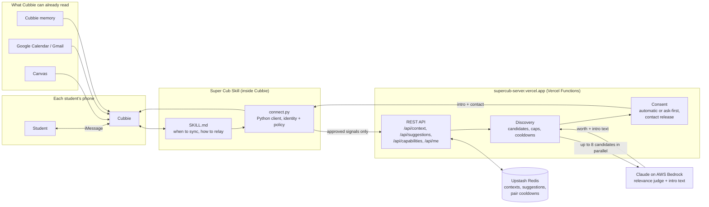

# Super Cub

**Your network that grows with you.** Super Cub is a Cubbie Skill. As your classes, projects and plans change, it finds people at your school, and later alumni, who are on the same path, and introduces you.

Built for the Cubbie Hackathon.

## How it works

1. **Join once.** Cubbie shows one setup summary: your profile, the contact you choose to share, and the kinds of connections you want. One yes turns on automatic introductions, event sharing and a check-in every 2 hours.
2. **Cubbie notices.** When you mention something new, or Cubbie reads it in an email you asked it to check ("See you at DevHacks!"), it confirms in one line and syncs right away. It sends short approved facts, never the message itself.
3. **Super Cub finds the fit.** The server compares your approved facts with everyone else's. A Claude model on AWS Bedrock judges whether a connection is actually useful and writes the intro.
4. **You get introduced.** When both people have joined, Cubbie relays the intro with the other person's profile and contact, for example: "Marcus is a frontend dev who can help with React and is also going to DevHacks." Sync also says how many others are going to the same event.

## Architecture

What leaves Cubbie is a short list of typed signals (`enrolled_in`, `working_on`, `looking_for`, `can_help_with`, `interested_in`, `attending`, `open_to`), the chosen contact and an approved profile. No chat history, email bodies, grades or private calendar titles.

## Rules the server enforces

- Up to 5 suggestions per person per day (`SUPERCUB_MAX_PER_DAY`).
- After an intro, the same two people can be matched again an hour later for a new reason; the same reason waits a day.
- With the model configured, any useful reason counts. Without it, a rules fallback needs a concrete overlap.
- Contacts are released only when both people have joined with automatic intros, or both answered yes (for anyone who chose ask-first).
- "Leave super cub" deletes the person's server records and local state.

## Try it

Text this link to your Cubbie: https://github.com/dkoyi/Cubs/tree/main/supercub

Approve the install, reply yes to the setup summary, then try "Anyone going to DevHacks?" or "I need frontend help for my AI project."

## Run it yourself

- `supercub/`: the Skill (`SKILL.md`, `references/`) and the standard-library Python client `scripts/connect.py`.
- `server/`: TypeScript Vercel Functions with an Upstash Redis store and an optional Anthropic/Bedrock judge. Deploy with `vercel deploy --prod` from `server/`; set `KV_REST_API_URL`, `KV_REST_API_TOKEN`, AWS credentials and optionally `SUPERCUB_MODEL`.
- `site/`: install page, hosted at `supercub-site.vercel.app`.
- `scripts/seed-demo-students.py`: seeds 10 synthetic sample profiles (contacts on the reserved `@supercub.test` domain) for demos; `leave` removes them.

Checks: `cd server && pnpm typecheck && pnpm test`, and `python3 -m unittest discover -s tests` from the root. All tests use synthetic data.
